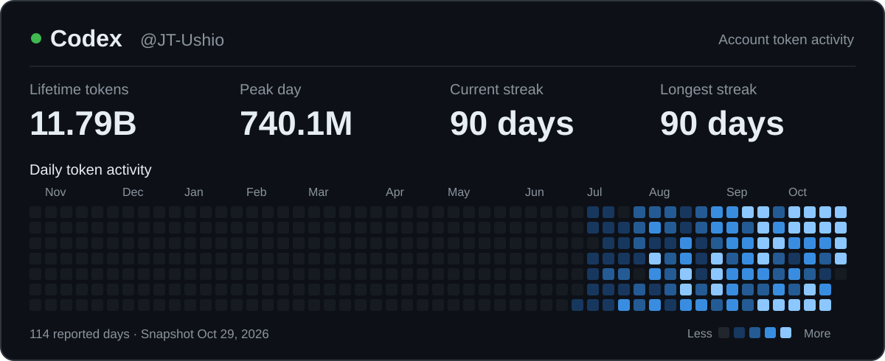

# Tao Ji · 紀焘

**Assistant Professor & Ph.D. Advisor · Fudan University**

My research bridges Linguistics and Computer Science, focusing on the architectural design and development of LLMs.

I am particularly interested in:

- Efficient infrastructure via algorithm-hardware co-design
- Language-centric multimodal in-context learning
- Native long-context modeling in LLMs

[Google Scholar](https://scholar.google.com/citations?user=tZlj-O8AAAAJ)

## Codex Usage

## Research Group (including co-advised students)

<!-- 最多每行 5 人。姓名采用英文名或“名 + 姓”的拼音；增加学生时可复制一个 <td>。 -->

### PhD Students

<table>
  <tr>
    <td align="center" width="140">
      <a href="https://github.com/lichee7">
         
        <b>Qi Li</b>
      </a> 
      <a href="https://github.com/lichee7">@lichee7</a>
    </td>
    <td align="center" width="140">
      <a href="https://github.com/Knlife">
         
        <b>Jiahao Kuang</b>
      </a> 
      <a href="https://github.com/Knlife">@Knlife</a>
    </td>
    <td align="center" width="140">
      <a href="https://github.com/SchweitzerGAO">
         
        <b>Yangfan Gao</b>
      </a> 
      <a href="https://github.com/SchweitzerGAO">@SchweitzerGAO</a>
    </td>
    <td align="center" width="140">
      <a href="https://github.com/sjyouuuuug">
         
        <b>Jiayang Shi</b>
      </a> 
      <a href="https://github.com/sjyouuuuug">@sjyouuuuug</a>
    </td>
    <td align="center" width="140">
      <a href="https://github.com/scv11">
         
        <b>Zhichao Sun</b>
      </a> 
      <a href="https://github.com/scv11">@scv11</a>
    </td>
  </tr>
  <tr>
    <td align="center" width="140">
      <a href="https://github.com/RmZeta2718">
         
        <b>Jie Wang</b>
      </a> 
      <a href="https://github.com/RmZeta2718">@RmZeta2718</a>
    </td>
  </tr>
</table>

### Master's Students

<table>
  <tr>
    <td align="center" width="140">
      <a href="https://github.com/HaZ-K">
         
        <b>Jiazheng Zhou</b>
      </a> 
      <a href="https://github.com/HaZ-K">@HaZ-K</a>
    </td>
    <td align="center" width="140">
      <a href="https://github.com/Feanus">
         
        <b>Rui Wang</b>
      </a> 
      <a href="https://github.com/Feanus">@Feanus</a>
    </td>
  </tr>
</table>

### Undergraduate Students

<table>
  <tr>
    <td align="center" width="140">
      <a href="https://github.com/expectqwq">
         
        <b>Zile Wang</b>
      </a> 
      <a href="https://github.com/expectqwq">@expectqwq</a>
    </td>
    <td align="center" width="140">
      <a href="https://github.com/CHiSwsz">
         
        <b>Zhide Xie</b>
      </a> 
      <a href="https://github.com/CHiSwsz">@CHiSwsz</a>
    </td>
    <td align="center" width="140">
      <a href="https://github.com/Whisper">
         
        <b>Kaidi Shu</b>
      </a> 
      <a href="https://github.com/Whisper">@Whisper</a>
    </td>
    <td align="center" width="140">
      <a href="https://github.com/Xingyan325">
         
        <b>Yan Xing</b>
      </a> 
      <a href="https://github.com/Xingyan325">@Xingyan325</a>
    </td>
    <td align="center" width="140">
      <a href="https://github.com/PeidaMiao">
         
        <b>Peida Miao</b>
      </a> 
      <a href="https://github.com/PeidaMiao">@PeidaMiao</a>
    </td>
  </tr>
</table>

## Teaching

| Course | Repository |
| --- | --- |
| Natural Language Processing and Language Acquisition | [nlp-and-la-spring-2026](https://github.com/JT-Ushio/nlp-and-la-spring-2026) |
| Natural Language Logic and Natural Language Processing | [nll-and-nlp-spring-2026](https://github.com/JT-Ushio/nll-and-nlp-spring-2026) |
| Language-Centric Generative AI | [Lang-GenAI-Fall-2026](https://github.com/JT-Ushio/Lang-GenAI-Fall-2026) |

## Selected Projects

- [**MLAfication**](https://github.com/JT-Ushio/MLAfication) — Adapting pretrained language and vision-language models to use Multi-Head Latent Attention.
